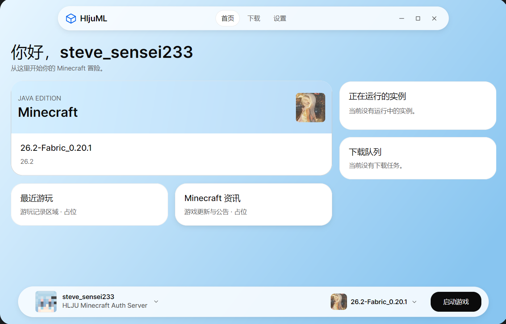
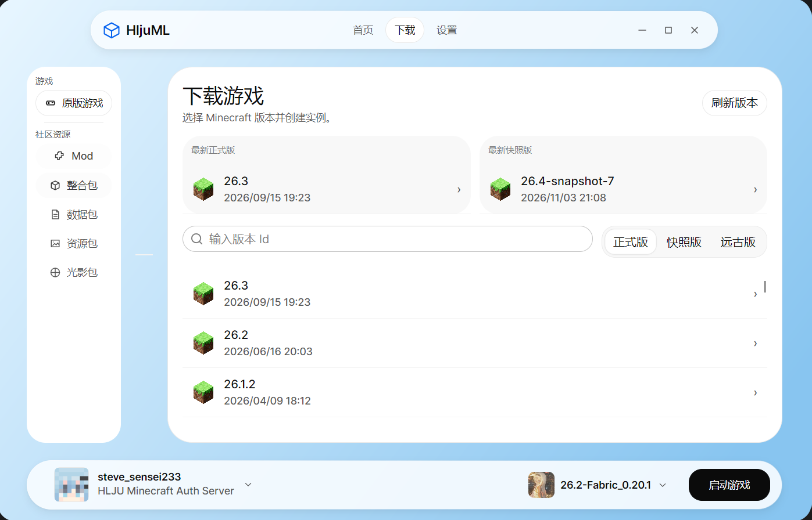

# HljuML

English | [简体中文](README.zh-CN.md)

> [!IMPORTANT]
>
> HljuML still under active development, please do not use it in production environments for now.

HljuML is a desktop launcher for Minecraft: Java Edition, built on [ColorMC](https://github.com/Coloryr/ColorMC). It brings account management, game instances, game downloads, and Java environment selection into one interface.

The project is develop for Heilongjiang University Minecraft Club, You can join us [here](https://qm.qq.com/q/tHn03n12Mg)

## Platforms

| Platform | Status |
| --- | --- |
| Windows | Current development and build verification platform. |
| Linux | Intended desktop target; not yet verified for HljuML. |
| macOS | Intended desktop target; not yet verified for HljuML. |

## Screenshots

<details>
<summary>Img</summary>





</details>

## Build from source

Install [Git](https://git-scm.com/downloads) and the [.NET 10 SDK](https://dotnet.microsoft.com/download/dotnet/10.0). A compatible Java installation is needed to launch Minecraft, but not to build the launcher.

Clone this repository, then run these commands from its root directory:

```sh
git submodule update --init --recursive
dotnet restore HljuML.slnx
dotnet build HljuML.slnx -c Release --no-restore
```

Run the launcher:

```sh
dotnet run --project HljuML.App/HljuML.App.csproj -c Release --no-build
```

Build output is located in `HljuML.App/bin/Release/net10.0/`. Use Git to obtain the source: GitHub source ZIP downloads do not include the ColorMC submodule.

## License

Original HljuML source code is licensed under the [Apache License 2.0](LICENSE), unless otherwise stated. It permits commercial use, modification, and redistribution subject to its terms, and includes an express patent license.

ColorMC is also [Apache-2.0 licensed](https://github.com/Coloryr/ColorMC/blob/main/LICENSE). Other dependencies retain their own licenses, including MIT, BSD, ISC, and the SIL Open Font License. See [Third-party notices](THIRD_PARTY_NOTICES.md) for the dependency license summary and developer-tool exceptions.

Third-party artwork, logos, and trademarks are not relicensed by this project's license. HljuML is an independent project and is not affiliated with Mojang or Microsoft.


## Special Thanks

- [ColorMC](https://github.com/Coloryr/ColorMC)

    - Thanks `ColorMC.Core` provide a full suite of Minecraft launcher features, HljuML developed on top of it