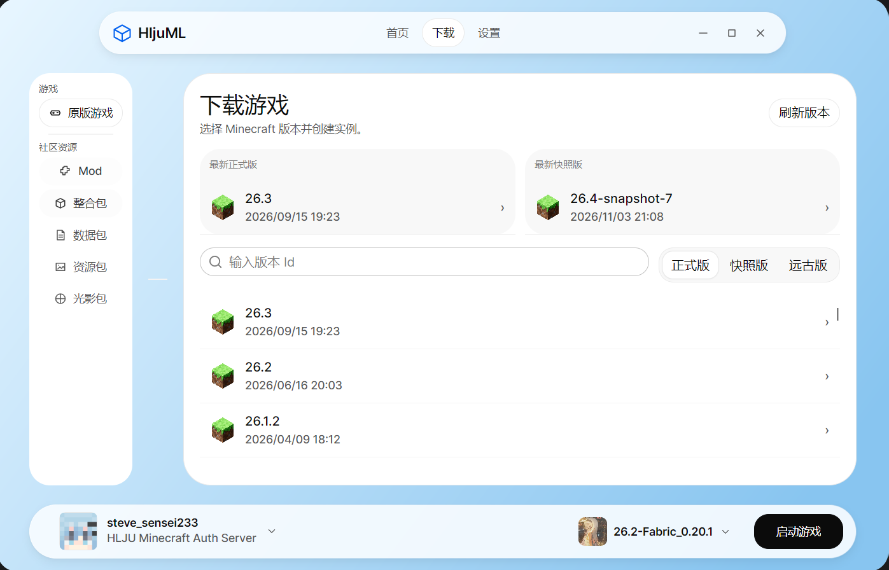

# HljuML

[English](README.md) | 简体中文

> [!IMPORTANT]
>
> HljuML当前仍在各种开发，请暂时不要用于生产环境

HljuML 是一款基于 [ColorMC](https://github.com/Coloryr/ColorMC) 开发的 Minecraft Java 版桌面启动器，将账号管理、游戏实例、游戏下载和 Java 环境选择整合到同一个界面中。

本项目为黑龙江大学Minecraft同好会开发，你可以在[这里](https://qm.qq.com/q/tHn03n12Mg)加入我们

## 支持平台

| 平台 | 状态 |
| --- | --- |
| Windows | 当前开发及构建验证平台。 |
| Linux | 计划支持的桌面平台，尚未验证 HljuML 的兼容性。 |
| macOS | 计划支持的桌面平台，尚未验证 HljuML 的兼容性。 |

## 项目图片

<details>
<summary>截图</summary>




</details>


## 从源码构建

安装 [Git](https://git-scm.com/downloads) 和 [.NET 10 SDK](https://dotnet.microsoft.com/download/dotnet/10.0)。运行 Minecraft 还需要兼容的 Java 环境，构建启动器本身不需要 Java。

使用 Git 克隆本仓库，然后在仓库根目录执行：

```sh
git submodule update --init --recursive
dotnet restore HljuML.slnx
dotnet build HljuML.slnx -c Release --no-restore
```

运行启动器：

```sh
dotnet run --project HljuML.App/HljuML.App.csproj -c Release --no-build
```

构建产物位于 `HljuML.App/bin/Release/net10.0/`。请使用 Git 获取源码，GitHub 的源码 ZIP 下载不包含 ColorMC 子模块。

## 开源许可证

除另有说明外，HljuML 的原创源代码采用 [Apache License 2.0](LICENSE)。该协议允许在遵守条款的前提下商业使用、修改及再分发，并包含明确的专利授权。

核心依赖 ColorMC 同样采用 [Apache-2.0](https://github.com/Coloryr/ColorMC/blob/main/LICENSE)。其他依赖保留各自的许可证，包括 MIT、BSD、ISC 和 SIL Open Font License。依赖协议摘要及开发工具的单独条款见[第三方声明](THIRD_PARTY_NOTICES.md)。

第三方图片、标志和商标不因本项目的许可证而被重新授权。HljuML 是独立项目，与 Mojang 或 Microsoft 无隶属关系。

## 特别鸣谢

- [ColorMC](https://github.com/Coloryr/ColorMC)

  - 感谢ColorMC.Core所提供的Minecraft启动器全家桶级基础功能，HljuML在其基础上开发